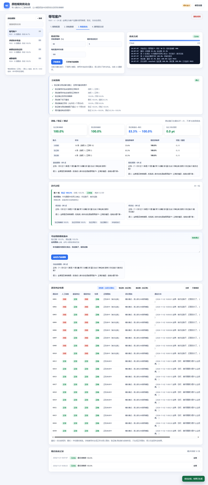

# 质检规则优化台（简化版）

把「自动质检规则」和「人工复核结果」放在一起，让大模型自动改写规则的 **正则表达式** 和 **语义描述**，
并用同一批标注通话反复评测，直到准确率达到设定目标。

这是原「外呼质检离线自进化工作台」的简化实现，只保留一期真正需要的闭环：

```
导入通话数据 → 选择一条规则 → 评测当前准确率 → 大模型给出候选规则 → 复评 → 保留更优版本 → 达标后应用
```

去掉了原项目的封存验收、审批、影子/灰度/发布/回滚、审计与复杂状态机。



*示意：30 通验证数据，训练/验证/测试三集均提升，泛化验收 PASS。*

## 启动

在项目根目录双击 `start.cmd`，或执行：

```powershell
powershell -ExecutionPolicy Bypass -File scripts\dev.ps1
```

浏览器打开 <http://127.0.0.1:8090>。停止：

```powershell
powershell -ExecutionPolicy Bypass -File scripts\stop.ps1
```

也可以双击 `stop.cmd`。运行日志在 `.run\app.log`，数据在 `data\store.json`。

## 本机环境

所有项目文件、虚拟环境、数据和日志都在 E 盘，不写 C 盘：

| 内容 | 位置 |
| --- | --- |
| 项目 | `E:\qc-rule-optimizer` |
| Python 虚拟环境 | `E:\qc-rule-optimizer\.venv` |
| 运行时（JDK / Maven / Node） | `E:\qc-runtimes` |
| 数据文件 | `E:\qc-rule-optimizer\data\store.json` |
| 运行日志 | `E:\qc-rule-optimizer\.run\app.log` |

Python 解释器使用本机已有的 3.9（位于 C 盘系统目录，只读使用）；依赖装在 E 盘的 `.venv` 中。

## 使用流程

1. **规则配置**：左侧选中规则，编辑规则编号、名称、业务说明、正则、语义描述和逻辑关系，保存。
2. **训练数据**：导入通话数据（CSV / JSON / XLSX），核对通话数、本规则的违规/正常分布和原自动质检准确率。
3. **智能优化**：设置目标准确率与最大轮次，点击「开始优化」。页面会显示每轮候选规则、指标变化和逐条判定结果；
   达标后点击「应用为当前规则」写回规则。

内置 4 条演示规则（R001～R004）和 10 通合成通话，打开即可直接体验；示例文件在
[`samples/import-calls-10.csv`](samples/import-calls-10.csv)，页面上也可以直接下载。

## 规则模型

每条规则由两部分组成：

| 部分 | 说明 |
| --- | --- |
| 规则编号 | 如 `R003`，导入文件的第三、四列用它标识规则；同一规则库内唯一 |
| 正则表达式 | Python `re` 语法，对通话全文执行 `re.search`，命中即视为该部分成立 |
| 语义描述 | 给大模型判断的违规条件，例如「坐席是否主动索要客户收到的短信验证码；提醒客户不要泄露不算」 |

逻辑关系：

- **OR（或）**：正则或语义任一命中 → 违规（默认）
- **AND（与）**：正则和语义都命中 → 违规

规则默认口径是 **「命中即违规」**。语义为空的规则只跑正则；正则为空的规则只调用语义模型。
评测时会短路：OR 下正则已命中就不再调用模型，AND 下正则未命中也不调用，以节省费用。

## 数据格式

一行一通电话，四列（支持 `.csv`、`.json`、`.xlsx`）：

| 列 | 必填 | 说明 |
| --- | --- | --- |
| 通话ID | 否 | 缺省时自动生成；追加导入时按它去重 |
| 通话文本 | 是 | 转写文本，可多行，建议保留「（时间 坐席/客户：内容」格式 |
| 自动违规规则 | 否 | 自动质检判定的违规规则编号；没有违规留空 |
| 人工违规规则 | 是 | 人工复核的违规规则编号；没有违规留空 |

规则编号可以填多个，用 `;`、`、`、`,` 或空格分隔。编号也兼容直接写规则名称。

**同一通电话会按每条规则派生一个样本**：规则编号出现在人工列 → 该规则「违规」，否则「正常」。
因此导入 10 通电话后，每条规则都有 10 个样本，人工列里出现该编号的才算正样本。

示例：

```csv
通话ID,通话文本,自动违规规则,人工违规规则
C001,"（2026-11-01 21:00:01 坐席：今天不还钱就上门催收。
2026-11-01 21:00:12 客户：我这两天就还。
）",R004,R004
C002,"（2026-11-01 21:05:10 坐席：请把收到的验证码告诉我。
2026-11-01 21:05:16 客户：是 123456 吗？
）",R003,R003
C003,"（2026-11-01 21:10:02 坐席：就你这脑子还是别办了。
）",,R001
```

列名也兼容 `call_id`、`transcript`、`auto_rules`、`human_rules` 等英文写法。

## 训练 / 验证 / 测试与泛化验收

为了不让规则“背训练数据”，每条规则都会**独立**按 60% / 20% / 20% 分层切分：

| 集合 | 用途 | 谁能看 |
| --- | --- | --- |
| 训练集 | 给优化器看错误样本、生成候选 | 优化器可见 |
| 验证集 | 比较候选、决定采纳哪一版 | 只用于选择，不进入 prompt |
| 测试集 | 最终验收，只评一次 | 优化和选择阶段都不可见 |

切分按“通话”分组，并尽量让三个集合都包含违规和正常样本；规则之间互不影响
（同一通电话对 R001 可能在训练集，对 R003 可能在测试集）。不足 5 通时全部放入训练集，
并提示无法泛化验收。

优化流程：

1. 基线在训练集、验证集上评测；
2. 每轮把**训练集**的错误样本交给模型，生成候选；
3. 候选在训练集、验证集上复评，只有验证集变好才采纳；
4. 循环结束后，最优规则和基线在**测试集**上各评一次；
5. 按下面的检查表给出 PASS / FAIL / INSUFFICIENT。

| 检查项 | 通过条件 |
| --- | --- |
| 验证集/测试集同时有违规和正常样本 | 各至少 1 条 |
| 验证集达到目标准确率 | ≥ 目标 |
| 测试集不低于基线 | ≥ 基线 - 2pt |
| 测试集接近目标 | ≥ 目标 - 5pt |
| 验证集与测试集差距 | ≤ 15pt |
| 相对基线有实际提升 | 验证集或测试集提升 |

- **PASS**：可以直接应用。
- **FAIL**：验收未通过，应用按钮禁用；需要人工勾选“仍要应用”并填写理由才能强制应用。
- **INSUFFICIENT**：验证集或测试集缺少正/负样本，无法证明泛化能力，同样需要人工确认。

内置的 10 通演示数据里，部分规则只有 1～2 条正样本，验收会显示“样本不足”或“未通过”，
这是预期行为——它说明当前数据不足以证明泛化，而不是系统故障。换成几十上百通真实标注数据后
才容易得到 PASS。

## 准确率与指标

对当前选中的规则，以「人工违规规则里是否包含该规则编号」为真值，规则的正则+语义预测为正类：

- 准确率 = (TP + TN) / 全部样本
- 精确率 = TP / (TP + FP)，召回率 = TP / (TP + FN)
- FP = 误报（判违规但人工没标该规则），FN = 漏报（人工标了该规则但规则没判出来）

数据预览里的「自动是否正确」是同一个口径，只是把「规则预测」换成生产自动质检的判定：
自动列和人工列是否同时包含当前规则编号，一致即正确。

语义描述未变化时，会复用上一轮语义判定结果，避免重复调用模型。

## 修改理由与修改历史

每一次规则内容变化都必须留下理由：

- **人工保存**：修改正则、语义、逻辑、名称或编号时，必须填写「本次修改理由」；
- **应用优化结果**：必须填写「应用理由」，默认带入最后一轮的修改说明；
- 理由会连同版本号、时间、来源（人工修改 / 优化应用）、变化字段和修改前后内容一起写入
  `changeLog`，在规则页面的「修改历史与理由」中查看；
- 强制应用（验收未通过）会额外标记 `forced`，便于后续追溯。

## 逐条判定理由：训练集全量、验证/测试只给正则

为了兼顾“可解释”和“生产时延”，三个集合的语义理由策略不同：

| 集合 | 正则理由 | 语义判定 | 语义理由 |
| --- | --- | --- | --- |
| 训练集 | 有（命中片段/未命中） | 每条都调用 | 有（模型给出） |
| 验证集 | 有 | 按 OR/AND 短路调用 | 不生成 |
| 测试集 | 有 | 按 OR/AND 短路调用 | 不生成 |

- 训练集强制同时执行正则和语义，便于优化器理解每条样本为什么判对/判错；
- 验证集/测试集的语义调用只要求模型返回 `{"violation": true/false}`，**不生成 reason**，减少输出 token 和时延；
- 正则理由是本地生成的，不增加模型调用：命中时显示命中的片段，未命中时显示“正则未命中”。

结果页的「逐条判定结果」可以切换训练集 / 验证集 / 测试集，查看每通电话的两类理由。

## 通用语义提示词

「4. 通用提示词」页签可以配置生产上所有规则共用的语义提示词：


- 用 `{rules}` 占位符表示全部规则，运行时替换成 `规则编号（名称）：语义描述` 的列表；
- 页面实时展示实际发给模型的完整系统提示词预览；
- 修改提示词必须填写理由，并写入提示词修改历史；
- 优化任务可以在生成规则的同时提出新的提示词（要求保留 `{rules}`），迭代过程会展示提示词修改前后对比；
- 应用优化结果时，如果提示词也被采纳，会一并更新全局提示词并记录 `promptHistory`，之后所有规则的语义判定都会使用新提示词。

示例：

```
你是信用卡催收合规专家。请判断坐席是否违反下面列出的规则。
需要检查的规则有：
{rules}
```

## 模拟模式与真实模型

首次启动是 **模拟演示**：不调用任何模型，用本地启发式算法从误报/漏报样本中提炼排除词和同义表达，
用来演示页面流程；它**不会评估语义部分**，纯语义规则在模拟模式下不会改善。

接入真实模型：点击右上角「模型设置」：

- 运行模式：真实模型
- Base URL：`https://api.deepseek.com`（或任意 OpenAI 兼容网关）
- 模型名：`deepseek-chat` 等
- API Key：只保存在服务进程内存，不写入磁盘

保存后重新点击「开始优化」即可。也可以用环境变量启动：

```powershell
$env:DEEPSEEK_API_KEY = "你的 Key"
powershell -ExecutionPolicy Bypass -File scripts\dev.ps1
```

真实模式会为每条需要语义判断的样本调用一次模型。样本 100 条、5 轮，最多约 500 次调用，
建议先从 30～50 条、目标 90% 开始。界面中的「只评测当前规则」用于先看基线，避免直接消耗整轮优化费用。

## 目录

```
qc-rule-optimizer/
  app/
    main.py        FastAPI 路由、任务调度
    store.py       data/store.json 原子读写
    seed.py        演示规则与合成数据
    importer.py    CSV / JSON / XLSX 解析
    evaluator.py   正则 + 语义组合评测与指标
    optimizer.py   优化循环、大模型/模拟候选生成、泛化验收
    prompts.py     通用语义提示词默认模板、{rules} 渲染与校验
    splits.py      按规则分层切分训练/验证/测试集
    llm.py         DeepSeek / OpenAI 兼容客户端与语义判定
    models.py      请求模型、规则校验、标签归一化
  static/          单页前端（原生 HTML/CSS/JS，无需 npm）
  samples/import-calls-10.csv  10 通示例导入文件
  data/store.json  所有规则、通话数据与优化记录
  docs/            截图
  tests/           核心逻辑单元测试
  scripts/         Windows 启停脚本与启动器 launch.py
```

## 测试

```powershell
powershell -ExecutionPolicy Bypass -File scripts\test.ps1
```

或直接：

```powershell
.venv\Scripts\python.exe -m unittest discover -s tests -v
```

## 边界

- 单机、单进程、JSON 文件持久化；不适合多实例并发写入。
- 没有登录、权限和审批，只监听 `127.0.0.1`，供本地或内网演示。
- 只处理文本转写，不接录音、ASR、角色识别和业务系统。
- 正则使用 Python `re`，与生产质检引擎的正则方言可能不同，应用前需要人工确认。
- 真实模型会消耗 API 额度；优化结果不保证泛化，必须用独立数据复验后再上线。
