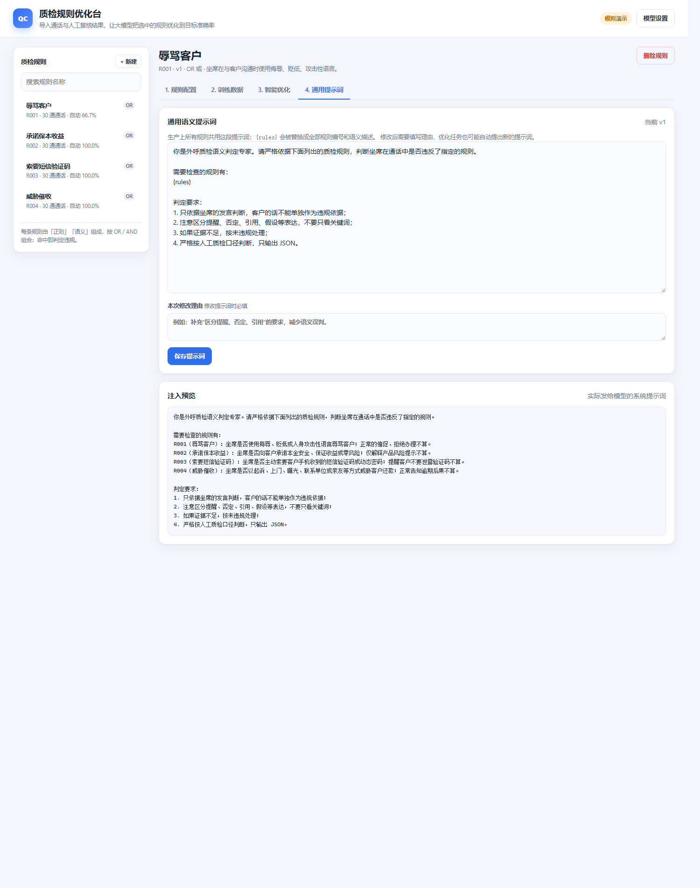
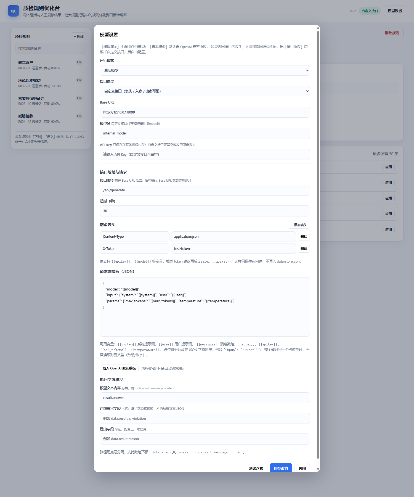
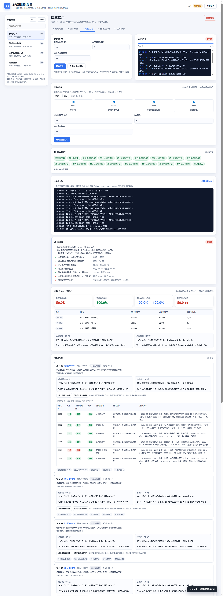
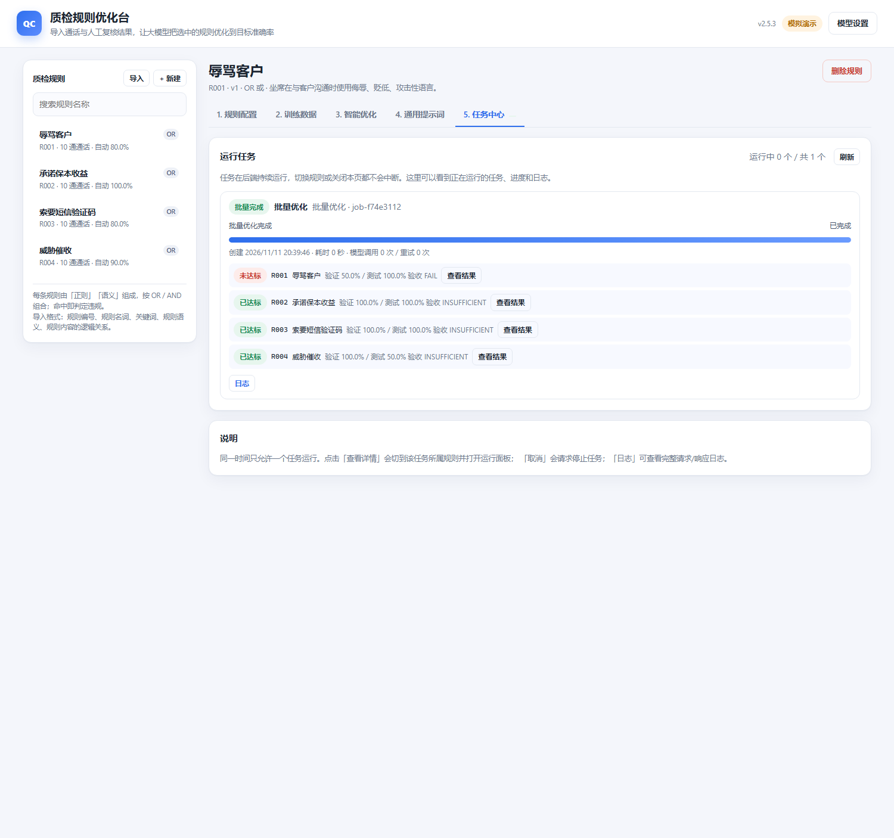
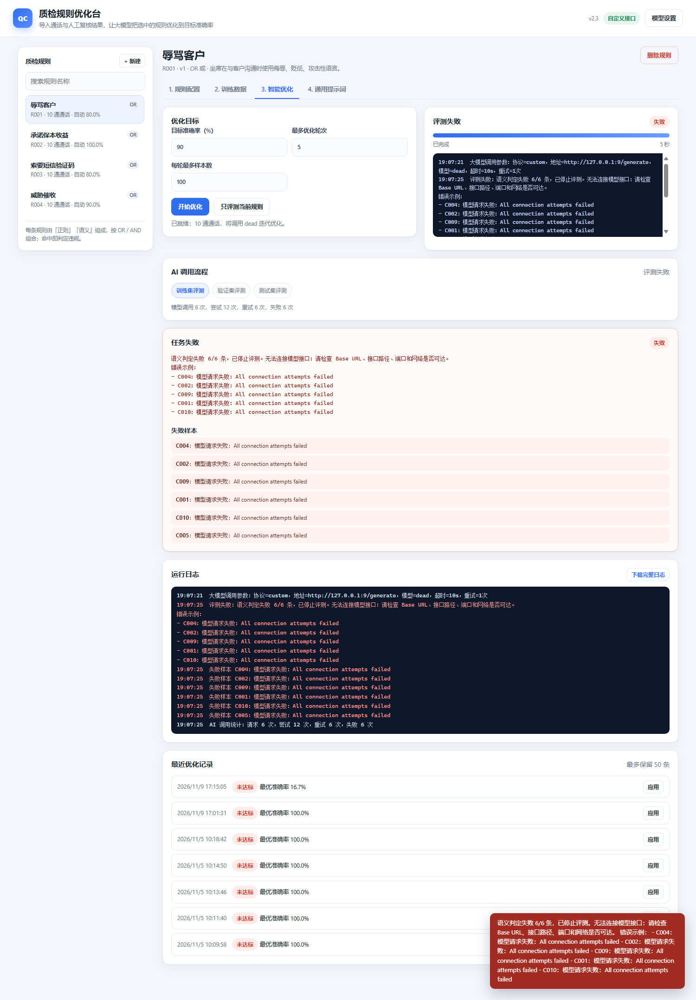

# 质检规则优化台（简化版）

把「自动质检规则」和「人工复核结果」放在一起，让大模型自动改写规则的 **正则表达式** 和 **语义描述**，
并用同一批标注通话反复评测，直到准确率达到设定目标。

这是原「外呼质检离线自进化工作台」的简化实现，只保留一期真正需要的闭环：

```
导入通话数据 → 选择一条规则 → 评测当前准确率 → 大模型给出候选规则 → 复评 → 保留更优版本 → 达标后应用
```

去掉了原项目的封存验收、审批、影子/灰度/发布/回滚、审计与复杂状态机。


*示意：30 通验证数据，训练/验证/测试三集均提升，泛化验收 PASS。*

## 启动（离线内网版）

把压缩包拷贝到内网 Windows 机器，解压后进入 `qc-rule-optimizer` 目录，**双击 `start.cmd`**。

- 不需要联网，不需要安装 Python、pip 或任何依赖；
- 包内自带 Python 3.8.0（VS2017 构建，适配 VC++2017）和全部 wheel 依赖；
- 首次启动约 10～20 秒，浏览器会自动打开 <http://127.0.0.1:8090>；
- 停止：双击 `stop.cmd`。

如果浏览器没有自动弹出，手动打开 <http://127.0.0.1:8090>。运行日志在 `.run\app.log`，数据在 `data\store.json`。

### 离线包内容

| 目录/文件 | 说明 |
| --- | --- |
| `runtime\python` | 自带 Python 3.8.0（64 位，VS2017 构建）及已安装依赖 |
| `wheelhouse` | 全部离线 wheel 包（cp38 / win_amd64） |
| `app`、`static`、`scripts` | 程序和页面 |
| `samples` | 10 通示例导入数据 |
| `data\store.json` | 首次启动自动生成的本地数据 |

### 如果自带运行时不可用

`scripts\dev.ps1` 会自动回退到本机 `py -3.8` / `python`（必须是 3.8 64 位），
从本地 `wheelhouse` 创建 `.venv` 并离线安装，不访问网络。详见 [OFFLINE.md](OFFLINE.md)。

## 本机环境

所有数据、日志和依赖都在解压目录内，不写系统目录：

| 内容 | 位置 |
| --- | --- |
| 项目 | 解压后的 `qc-rule-optimizer` 目录 |
| Python 运行时 | `runtime\python`（自带 3.8.0，适配 VC++2017） |
| 离线依赖 | `wheelhouse` |
| 数据文件 | `data\store.json` |
| 运行日志 | `.run\app.log` |

## 使用流程

1. **规则配置**：左侧选中规则，编辑规则编号、名称、业务说明、正则、语义描述和逻辑关系，保存。
2. **训练数据**：导入通话数据（CSV / JSON / XLSX），核对通话数、本规则的违规/正常分布和原自动质检准确率。
3. **智能优化**：设置目标准确率与最大轮次，点击「开始优化」。页面会显示每轮候选规则、指标变化和逐条判定结果；
   达标后点击「应用为当前规则」写回规则。

内置 4 条演示规则（R001～R004）和 10 通合成通话，打开即可直接体验；示例文件在
[`samples/import-calls-10.csv`](samples/import-calls-10.csv)，页面上也可以直接下载。

## 规则模型

每条规则由两部分组成：

| 部分 | 说明 |
| --- | --- |
| 规则编号 | 如 `R003`，导入文件的第三、四列用它标识规则；同一规则库内唯一 |
| 正则表达式 | Python `re` 语法，对通话全文执行 `re.search`，命中即视为该部分成立 |
| 语义描述 | 给大模型判断的违规条件，例如「坐席是否主动索要客户收到的短信验证码；提醒客户不要泄露不算」 |

逻辑关系：

- **OR（或）**：正则或语义任一命中 → 违规（默认）
- **AND（与）**：正则和语义都命中 → 违规

规则默认口径是 **「命中即违规」**。语义为空的规则只跑正则；正则为空的规则只调用语义模型。
评测时会短路：OR 下正则已命中就不再调用模型，AND 下正则未命中也不调用，以节省费用。

## 数据格式

一行一通电话，四列（支持 `.csv`、`.json`、`.xlsx`）：

| 列 | 必填 | 说明 |
| --- | --- | --- |
| 通话ID | 否 | 缺省时自动生成；追加导入时按它去重 |
| 通话文本 | 是 | 转写文本，可多行，建议保留「（时间 坐席/客户：内容」格式 |
| 自动违规规则 | 否 | 自动质检判定的违规规则编号；没有违规留空 |
| 人工违规规则 | 是 | 人工复核的违规规则编号；没有违规留空 |

规则编号可以填多个，用 `;`、`、`、`,` 或空格分隔。编号也兼容直接写规则名称。

**同一通电话会按每条规则派生一个样本**：规则编号出现在人工列 → 该规则「违规」，否则「正常」。
因此导入 10 通电话后，每条规则都有 10 个样本，人工列里出现该编号的才算正样本。

示例：

```csv
通话ID,通话文本,自动违规规则,人工违规规则
C001,"（2026-11-01 21:00:01 坐席：今天不还钱就上门催收。
2026-11-01 21:00:12 客户：我这两天就还。
）",R004,R004
C002,"（2026-11-01 21:05:10 坐席：请把收到的验证码告诉我。
2026-11-01 21:05:16 客户：是 123456 吗？
）",R003,R003
C003,"（2026-11-01 21:10:02 坐席：就你这脑子还是别办了。
）",,R001
```

列名也兼容 `call_id`、`transcript`、`auto_rules`、`human_rules` 等英文写法。

## 训练 / 验证 / 测试与泛化验收

为了不让规则“背训练数据”，每条规则都会**独立**按 60% / 20% / 20% 分层切分：

| 集合 | 用途 | 谁能看 |
| --- | --- | --- |
| 训练集 | 给优化器看错误样本、生成候选 | 优化器可见 |
| 验证集 | 比较候选、决定采纳哪一版 | 只用于选择，不进入 prompt |
| 测试集 | 最终验收，只评一次 | 优化和选择阶段都不可见 |

切分按“通话”分组，并尽量让三个集合都包含违规和正常样本；规则之间互不影响
（同一通电话对 R001 可能在训练集，对 R003 可能在测试集）。不足 5 通时全部放入训练集，
并提示无法泛化验收。

优化流程：

1. 基线在训练集、验证集上评测；
2. 每轮把**训练集**的错误样本交给模型，生成候选；
3. 候选在训练集、验证集上复评，只有验证集变好才采纳；
4. 循环结束后，最优规则和基线在**测试集**上各评一次；
5. 按下面的检查表给出 PASS / FAIL / INSUFFICIENT。

| 检查项 | 通过条件 |
| --- | --- |
| 验证集/测试集同时有违规和正常样本 | 各至少 1 条 |
| 验证集达到目标准确率 | ≥ 目标 |
| 测试集不低于基线 | ≥ 基线 - 2pt |
| 测试集接近目标 | ≥ 目标 - 5pt |
| 验证集与测试集差距 | ≤ 15pt |
| 相对基线有实际提升 | 验证集或测试集提升 |

- **PASS**：可以直接应用。
- **FAIL**：验收未通过，应用按钮禁用；需要人工勾选“仍要应用”并填写理由才能强制应用。
- **INSUFFICIENT**：验证集或测试集缺少正/负样本，无法证明泛化能力，同样需要人工确认。

内置的 10 通演示数据里，部分规则只有 1～2 条正样本，验收会显示“样本不足”或“未通过”，
这是预期行为——它说明当前数据不足以证明泛化，而不是系统故障。换成几十上百通真实标注数据后
才容易得到 PASS。

## 准确率与指标

对当前选中的规则，以「人工违规规则里是否包含该规则编号」为真值，规则的正则+语义预测为正类：

- 准确率 = (TP + TN) / 全部样本
- 精确率 = TP / (TP + FP)，召回率 = TP / (TP + FN)
- FP = 误报（判违规但人工没标该规则），FN = 漏报（人工标了该规则但规则没判出来）

数据预览里的「自动是否正确」是同一个口径，只是把「规则预测」换成生产自动质检的判定：
自动列和人工列是否同时包含当前规则编号，一致即正确。

语义描述未变化时，会复用上一轮语义判定结果，避免重复调用模型。

## 修改理由与修改历史

每一次规则内容变化都必须留下理由：

- **人工保存**：修改正则、语义、逻辑、名称或编号时，必须填写「本次修改理由」；
- **应用优化结果**：必须填写「应用理由」，默认带入最后一轮的修改说明；
- 理由会连同版本号、时间、来源（人工修改 / 优化应用）、变化字段和修改前后内容一起写入
  `changeLog`，在规则页面的「修改历史与理由」中查看；
- 强制应用（验收未通过）会额外标记 `forced`，便于后续追溯。

## 逐条判定理由：训练集全量、验证/测试只给正则

为了兼顾“可解释”和“生产时延”，三个集合的语义理由策略不同：

| 集合 | 正则理由 | 语义判定 | 语义理由 |
| --- | --- | --- | --- |
| 训练集 | 有（命中片段/未命中） | 每条都调用 | 有（模型给出） |
| 验证集 | 有 | 按 OR/AND 短路调用 | 不生成 |
| 测试集 | 有 | 按 OR/AND 短路调用 | 不生成 |

- 训练集强制同时执行正则和语义，便于优化器理解每条样本为什么判对/判错；
- 验证集/测试集的语义调用只要求模型返回 `{"violation": true/false}`，**不生成 reason**，减少输出 token 和时延；
- 正则理由是本地生成的，不增加模型调用：命中时显示命中的片段，未命中时显示“正则未命中”。

结果页的「逐条判定结果」可以切换训练集 / 验证集 / 测试集，查看每通电话的两类理由。

## 通用语义提示词

「4. 通用提示词」页签可以配置生产上所有规则共用的语义提示词：



- 用 `{rules}` 占位符表示全部规则，运行时替换成 `规则编号（名称）：语义描述` 的列表；
- 页面实时展示实际发给模型的完整系统提示词预览；
- 修改提示词必须填写理由，并写入提示词修改历史；
- 优化任务可以在生成规则的同时提出新的提示词（要求保留 `{rules}`），迭代过程会展示提示词修改前后对比；
- 应用优化结果时，如果提示词也被采纳，会一并更新全局提示词并记录 `promptHistory`，之后所有规则的语义判定都会使用新提示词。

示例：

```
你是信用卡催收合规专家。请判断坐席是否违反下面列出的规则。
需要检查的规则有：
{rules}
```

## 模拟模式与真实模型

首次启动是 **模拟演示**：不调用任何模型，用本地启发式算法从误报/漏报样本中提炼排除词和同义表达，
用来演示页面流程；它**不会评估语义部分**，纯语义规则在模拟模式下不会改善。

接入真实模型：点击右上角「模型设置」。

默认是 **OpenAI 兼容**：

- 运行模式：真实模型
- 接口协议：OpenAI 兼容
- Base URL：`https://api.deepseek.com`（或任意 OpenAI 兼容网关）
- 模型名：`deepseek-chat` 等
- API Key：只保存在服务进程内存，不写入磁盘

### 自定义接口（表头 / 入参 / 出参）

内网接口不是 OpenAI 格式时，把「接口协议」切成 **自定义接口**：



- **接口路径**：拼在 Base URL 后面；留空表示 Base URL 就是完整地址；
- **请求表头**：任意增删，值支持 `{{apiKey}}`、`{{model}}` 等变量；
  固定 token 可以直接写在表头里（注意会存到 `data\store.json`，敏感值建议用 `{{apiKey}}`）；
- **请求体模板**：JSON，项目把大模型需要的输入替换进模板：
  - `{{prompt}}`：完整提示词（系统提示词 + 业务提示词），**单入参接口用这个**
  - `{{system}}`：系统提示词
  - `{{user}}`：用户提示词
  - `{{messages}}`：`[{"role":"system",...},{"role":"user",...}]`
  - `{{model}}`、`{{apiKey}}`、`{{requestId}}`（每次调用唯一）、`{{max_tokens}}`、`{{temperature}}`
  - 占位符必须放在 JSON 字符串里；整个值只写一个占位符时，会保留数字/数组类型；
  - **请求体模板必须包含 `{{prompt}}`、`{{user}}` 或 `{{messages}}`**，否则不会上送当前规则和通话文本，保存/开始优化会被拒绝。只写 `{{system}}` 是不行的。
- **返回字段路径**：
  - `模型文本内容`：必填，如 `choices.0.message.content` 或 `result.answer`；
  - `违规布尔字段`、`理由字段`：可选；如果接口直接返回结果，填了这两个就不再解析文本 JSON；
  - 路径用点号分隔，支持数组下标，如 `data.items[0].answer`。

### 单入参 `question` 接口

如果内网接口的 body 只收一个字段，例如：

```json
{"question": "一次性输入大模型的内容", "sessionId": "testuuid"}
```

点「单入参 question 模板」，会自动配置：

```json
{
  "question": "{{prompt}}"
}
```

- 请求体只有 `question`；
- 返回路径填 `result.finalAnswer`；
- 不需要拆 `system` / `user`，也不需要单独的系统提示词字段。

注意：**接口可以不要求 system 字段，但项目仍需要把判断/优化要求放进 `question`**。`{{prompt}}` 就是项目自动拼好的完整要求，里面已经包含：

- 语义判定时：全局语义规则提示词 + 当前规则 + 通话文本 + 要求返回的 JSON 结构；
- 规则改写时：当前规则 + 训练集指标/错误样本 + 历史 + 要求返回的规则 JSON。

如果返回像截图这样：

```json
{
  "code": "0",
  "msg": "success",
  "result": {
    "finalAnswer": "{\"violation\": true, \"reason\": \"命中\"}"
  }
}
```

则「模型文本内容」填 `result.finalAnswer`，项目会从 `finalAnswer` 中解析 JSON。

示例：一个非 OpenAI 接口

```json
{
  "model": "{{model}}",
  "input": {"system": "{{system}}", "user": "{{user}}"},
  "params": {"max_tokens": "{{max_tokens}}", "temperature": "{{temperature}}"}
}
```

如果返回：

```json
{"result": {"answer": "{\"violation\": true, \"reason\": \"命中\"}"}}
```

则「模型文本内容」填 `result.answer`。

如果返回：

```json
{"data": {"result": {"is_violation": true, "reason": "命中"}}}
```

则填 `违规布尔字段 = data.result.is_violation`、`理由字段 = data.result.reason`。

保存后重新点击「开始优化」即可。也可以用环境变量启动：

```powershell
$env:DEEPSEEK_API_KEY = "你的 Key"
powershell -ExecutionPolicy Bypass -File scripts\dev.ps1
```

真实模式会为每条需要语义判断的样本调用一次模型。样本 100 条、5 轮，最多约 500 次调用，
建议先从 30～50 条、目标 90% 开始。界面中的「只评测当前规则」用于先看基线，避免直接消耗整轮优化费用。

## 规则文件导入

规则页左侧「导入」支持 CSV / JSON / XLSX，按**规则编号合并**：

- 文件里已有的编号：更新名称、关键词、语义、逻辑关系；
- 文件里没有的编号：新增规则；
- 文件中没有出现的现有规则：保持不动。

表头固定为：

| 规则编号 | 规则名词 | 关键词 | 规则语义 | 规则内容的逻辑关系 |
| --- | --- | --- | --- | --- |
| R005 | 诱导客户转账 | 转账\|汇款\|打款 | 坐席是否诱导客户向指定账户转账或汇款 | OR |
| R006 | 冒充公检法 | 公安局\|检察院\|法院 | 坐席是否冒充公检法人员要求客户配合 | AND |

说明：

- 关键词默认按**普通文本**处理，多个关键词用 `|`、`、`、`，`、`;` 分隔，自动转成正则；
- 如果关键词列本身就是完整正则，加 `re:` 前缀，例如 `re:(转账|汇款).{0,20}`；
- 逻辑关系支持 `OR/或`、`AND/与`，留空按 OR；
- 每行错误会单独提示，合法行仍会导入；
- 导入产生的修改会写入规则的 `changeLog`，来源为 `import`。

示例文件：[samples/import-rules-3.csv](samples/import-rules-3.csv)

## 每轮逐条结果

每个迭代轮次卡片现在都有：

- **训练集逐条结果**：每通电话的判定、正则命中理由、语义判定理由；
- **验证集逐条结果**：每通电话的判定、正则理由；语义只返回判定，不生成理由；
- 测试集不参与每轮选择，只在最终验收评测。

逐条结果按需加载，不会把所有轮次、所有样本一次性塞进页面。



对应接口：

```text
GET /api/jobs/{jobId}/iterations/{round}/cases?split=TRAIN
GET /api/jobs/{jobId}/iterations/{round}/cases?split=VALIDATION
```

## 批量优化

「智能优化」页下方新增「批量优化」：

- 勾选多条规则，或点「全选」优化全部规则；
- 可以单独设置目标、轮次和每轮样本数；
- 规则按顺序逐条优化，模型调用仍然是单发串行；
- 任务在「任务中心」显示，切换规则或页面不会中断；
- 每条规则的结果单独列出：验证/测试准确率、验收状态、查看结果、单独应用。

批量任务本身也是一个任务，同一时间仍然只允许一个任务运行。



## 运行日志、重试与超时

模型调用慢或接口不稳定时，在「模型设置」的「AI 调用设置」中配置：

- **单次超时**：默认 90 秒，可调到 300 秒；
- **失败重试次数**：默认 3 次，0 表示不重试；
- **重试间隔**：默认 1.5 秒，按尝试次数递增；
- **调用间隔**：默认 0.5 秒，每次调用后至少等待这么久。

模型调用固定为**单发**（并发 1），评测也是逐条串行，避免触发内网接口限流。

超时、连接失败、408/425/429/5xx 会自动重试；HTTP 400/401/403 这类配置或鉴权错误不会盲目重试。

优化/评测页面新增：

- **AI 调用流程**：基线训练 → 基线验证 → 每轮规则改写/训练/验证 → 测试验收；
- **AI 调用统计**：请求次数、尝试次数、重试次数、失败次数；
- **任务失败**：显示第一条错误的完整原因，并列出失败样本（通话 ID + 错误）；
- **运行日志**：带时间戳的分级日志，红色为错误；可点击「下载完整日志」保存到本地。

完整日志同时落盘在 `.run\jobs\<jobId>.log`，即使页面关闭或服务重启也能排查。日志包含每次调用的完整请求体、响应体和状态/耗时；`Authorization`、`token` 等敏感表头会脱敏。



如果基线评测很快失败，优先看「任务失败」里的错误示例：

- `HTTP 401/403`：鉴权/API Key/表头；
- `超时`：调大超时或重试；
- `不是 JSON`：模型没有按要求输出，或返回路径不对；
- `找不到字段`：返回路径与实际响应结构不一致；
- `All connection attempts failed`：Base URL、接口路径、端口或网络不可达。

## 目录

```
qc-rule-optimizer/
  app/
    main.py        FastAPI 路由、任务调度
    store.py       data/store.json 原子读写
    seed.py        演示规则与合成数据
    importer.py    CSV / JSON / XLSX 解析
    evaluator.py   正则 + 语义组合评测与指标
    optimizer.py   优化循环、大模型/模拟候选生成、泛化验收
    prompts.py     通用语义提示词默认模板、{rules} 渲染与校验
    splits.py      按规则分层切分训练/验证/测试集
    llm.py         DeepSeek / OpenAI 兼容客户端与语义判定
    models.py      请求模型、规则校验、标签归一化
  static/          单页前端（原生 HTML/CSS/JS，无需 npm）
  samples/import-calls-10.csv  10 通示例导入文件
  data/store.json  所有规则、通话数据与优化记录
  docs/            截图
  tests/           核心逻辑单元测试
  scripts/         Windows 启停脚本与启动器 launch.py
```

## 测试

```powershell
powershell -ExecutionPolicy Bypass -File scripts\test.ps1
```

或直接：

```powershell
.venv\Scripts\python.exe -m unittest discover -s tests -v
```

## 边界

- 单机、单进程、JSON 文件持久化；不适合多实例并发写入。
- 没有登录、权限和审批，只监听 `127.0.0.1`，供本地或内网演示。
- 只处理文本转写，不接录音、ASR、角色识别和业务系统。
- 正则使用 Python `re`，与生产质检引擎的正则方言可能不同，应用前需要人工确认。
- 真实模型会消耗 API 额度；优化结果不保证泛化，必须用独立数据复验后再上线。
